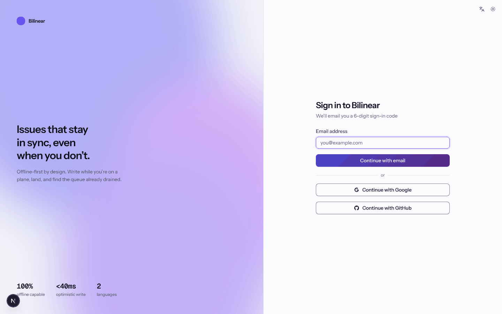
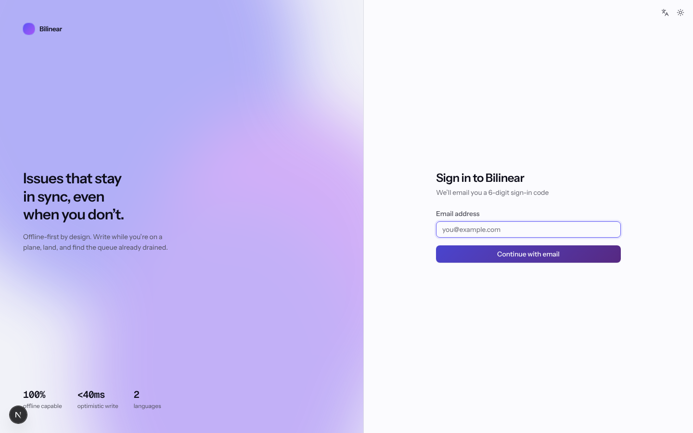

# Platform review — 2026-11-24

Four reviewers (two Opus, one Sonnet for research, one Haiku for screenshots) plus two Sonnet
engineers. Detail lives in:

- [`FINDINGS-issues.md`](FINDINGS-issues.md) — 26 findings on the core issue experience
- [`FINDINGS-platform.md`](FINDINGS-platform.md) — 26 findings on everything else
- [`RESEARCH.md`](RESEARCH.md) — competitor research, top-8 feature shortlist, UX checklist

## What shipped (22 findings fixed or partly fixed)

Gate on the final tree: `yarn lint`, `yarn lint:tokens`, `yarn typecheck` pass; `yarn test`
2426/2426. Not run: `yarn build`, e2e (Node 22 locally vs the 24 pin).

| Finding | Change | Evidence |
|---|---|---|
| ISS-01 | Closed issues no longer show overdue-red due dates | unit test |
| ISS-02 (half) | Cycle scope creep counts only issues added after the cycle starts. **Not fixed:** flat "Ideal" burndown line (chart `initialScope`) | unit test |
| ISS-04 | Board/list, group, order, swimlane persist per team | [board-persist](screenshots/features/board-persist.png) |
| ISS-06 | ⋯ actions menu on the issue page and panel (Archive/Delete reachable without right-click) | [menu](screenshots/features/issue-actions-menu.png) |
| ISS-08 | Sub-issue creation is optimistic (works offline) | unit test |
| ISS-11/12 | Filter form closes on Escape/outside click; dropdowns stop wrapping and show a checkmark | unit/type tests only, **no screenshot** |
| ISS-15/16/17/24 | Duplicate cycle name removed; sidebar expands the issue's team; stable team order; `Ctrl+B` vs `⌘B` tooltip | [issue-detail](screenshots/features/issue-detail.png) |
| PLT-01 | Workspace URL accepts hyphens | [onboarding-hyphen](screenshots/features/onboarding-hyphen.png) |
| PLT-02 | Reserved route keys (`admin`, `login`…) rejected | [onboarding-reserved](screenshots/features/onboarding-reserved.png) |
| PLT-04 | Login hides OAuth buttons that are not configured | before/after below |
| PLT-07/12/21/23/24/26 | Landing picks an accessible team; suspended workspaces' public roadmap 404s; localised invite role; magic link submits once; signed-in `/login` redirects | unit tests |
| PLT-18/19 | Analytics empty-state guard + team links; members no longer see admin-only settings sections | [analytics](screenshots/features/analytics.png), [settings-member](screenshots/features/settings-member.png) |
| PLT-09/10 (partly) | Initiative status is optimistic with rollback; rename; project/initiative unarchive with undo toast | `initiatives.png` was **not** re-checked after the change |
| PLT-03 (partly) | Signed-out redirect now carries `?next=` for the workspace/admin root. Full deep path needs a proxy (the app deliberately has none) | Playwright |

Every new test was confirmed to fail with its fix reverted, except one `onboarding-form.test.ts`
addition that was not revert-checked.

## Before → after

Login, signed out — Google/GitHub buttons that only produced an untranslated server error are gone
when the providers are not configured:

| Before | After |
|---|---|
|  |  |

Full sets: [`screenshots/before/`](screenshots/before/) and [`screenshots/after/`](screenshots/after/)
(desktop light, desktop dark, mobile 390px for ~26 routes each, same names in both folders).
Because most of the fixes are behavioural (menus, persistence, validation), their evidence is the
`screenshots/features/` set rather than a page-level diff.

## Caveats — read before trusting the screenshots

- **Some captures show loading skeletons.** The dev server compiles routes on demand and a fixed
  4s wait was not always enough (e.g. `before/settings-mobile-light.png`). Treat those as
  unreliable for visual comparison.
- **"Before" desktop shots for issue/team pages were taken before the first engineer's edits**; the
  settings/login/design baselines were re-shot later against unchanged code.
- **The platform reviewer could not sign in**, so its signed-in findings come from code reading,
  not the browser. Layout at 390px/1280px for those screens is covered only by the crawl.
- Turbopack panicked twice in the dev server; shots were taken in webpack mode.
- The board-toggle capture (`team-eng-board`) failed: the crawler's selector did not match.

## Not done — recommended next (from the findings)

Highest remaining value: ISS-03 (project/cycle/estimate filter pickers), ISS-05 (shortcuts on the
issue page), ISS-07 (set parent on an existing issue), ISS-09 (bulk cycle/project/due date),
PLT-06 (profile editing), PLT-11 (Slack/GitHub "not configured" state), PLT-13 (admin list
pagination), PLT-05 (SSO entry point). Feature ideas worth building first, per `RESEARCH.md`:
single-key triage actions, inbox Priority/Other tabs with snooze/unread, duplicate suggestions in
triage.

`AGENTS.md` shows as modified locally; the Next dev server regenerates it on start and it is
deliberately not part of this change.
